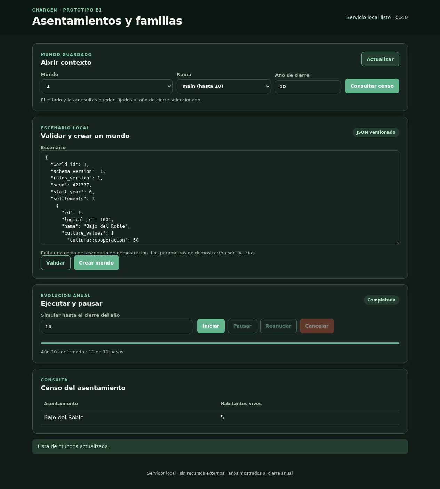

# Validación de E0/E1

Fecha: 12 de octubre de 2026. Implementación y recopilación delegadas en tres agentes **gpt-6-luna, razonamiento max**; planificación, revisión de contratos, integración y validación final realizadas por el agente principal.

## Resultado comprobado

Implementadas las fases F00–F05 hasta la capacidad E1: configuración y dominio Rust, contenedor explícito, interfaz local con recursos embebidos, motor anual reproducible, demografía y familias, historial SQLite, reanudación, ramas y consultas por cierre anual. Los procesos de F06 en adelante no entran en esta entrega. El alcance funcional y sus límites se detallan en [e1-scope.md](e1-scope.md).

- **37 pruebas Rust pasan:** 9 de dominio, 14 del motor, 9 de almacenamiento, 2 de consulta y 3 de aplicación.
- `cargo clippy --workspace --all-targets --locked --offline -- -D warnings` y `cargo fmt --all -- --check` pasan; sin advertencias.
- Compilación release con Rust **1.90.0**, Cargo.lock conservado, SQLite incluido en el binario mediante `rusqlite/bundled`.
- Contratos TypeScript comprobados con **5.9.3**; sintaxis JavaScript, recursos locales y workflows comprobados.
- El ejecutable y el paquete Linux extraído pasan `scripts/smoke-api.mjs`, también desde un directorio de trabajo temporal y con PATH aislado sin Python, Node ni Rust visibles para el ejecutable: validación, creación, cierre anual, censos/personas y reinicio del servicio.
- El paquete extraído pasa `scripts/validate-e1.mjs`: nacimientos y mortalidad exactos con censos **4/5/6**, genealogía sin hijos futuros, ramas por políticas y por estado inicial, rechazo de cambios contradictorios del prefijo, aislamiento de mundos en exportación/restauración, pausa, reanudación, cancelación y continuación posterior, reapertura del almacenamiento.
- Pruebas SQLite con tres puntos de fallo inyectado comprueban rollback de eventos, deltas, snapshots y head; las ramas sin cambios reproducen los cierres de la madre. El almacén verifica versiones, checksums e integridad y detecta manipulación del historial.
- Verificación en navegador: crear mundo, selección automática, simular cierres 0–10, consultar el censo del año 10 y refrescar el contexto desde almacenamiento. La demostración termina con cinco habitantes vivos.
- Archivo histórico Python preservado: **60 archivos** fuente, recursos, documentación y distribuciones con inventario SHA-256; **0 discrepancias** tras el traslado. Los cambios locales anteriores se mantienen en los contenidos archivados y no se ha restaurado ni sobrescrito el índice Git.

Las pruebas HTTP necesitan abrir sockets efímeros exclusivamente en loopback. El sandbox inicial los bloqueaba; se ejecutaron con la autorización automática correspondiente y terminaron correctamente. No se publicaron mundos ni datos fuera del equipo.

## Mediciones reales B0–B2

Equipo observado: Linux x86_64, Intel Core i7-9700K, 8 núcleos lógicos, 33.572.478.976 bytes de RAM física. Compilación release, una semilla por perfil, escritura de todos los cierres y eventos en SQLite. Tiempo anual incluye motor y persistencia; las huellas de estado completo se calculan por separado. RSS es un máximo muestreado entre años, no una cota de picos transitorios.

| Perfil | Población inicial | Lugares | Años | Tiempo de corrida | Media de vivos | Eventos | Pico RSS muestreado | Base durable |
| --- | ---: | ---: | ---: | ---: | ---: | ---: | ---: | ---: |
| B0 | 40 | 3 | 10 | 0,025 s | 40 | 7 | 8,2 MiB | 148 KiB |
| B1 | 1.000 | 10 | 100 | 1,85 s | 1.025,56 | 559 | 24,8 MiB | 2,98 MiB |
| B2 | 10.000 | 50 | 200 | 38,99 s | 10.058,62 | 6.631 | 152,5 MiB | 45,17 MiB |

Los informes completos incluyen tiempos por fase, consulta histórica, inicialización, población máxima/final y huellas deterministas: [B0](validation/b0.json), [B1](validation/b1.json), [B2](validation/b2.json). B2 consultó el censo final en 111 ms. Son perfiles ficticios de ingeniería; no acreditan el objetivo B3 de E5 ni una calibración demográfica. Este equipo tiene más RAM que los 16 GB de referencia y no se ha sustituido esa referencia por el equipo observado.

## Infraestructura preparada y aceptación pendiente

Los workflows [CI](../.github/workflows/ci.yml) y [release](../.github/workflows/release.yml) fijan acciones por SHA y herramientas, compilan/prueban en **Linux y Windows**, generan paquetes, extraen y prueban el ejecutable y comparan huellas deterministas B0 entre plataformas. La ejecución manual genera artefactos; la publicación se activa por etiqueta de versión. Windows compila con CRT estático y el checker inspecciona imports PE; la prueba local de ese parser utilizó una fixture sintética, no un binario Windows real. El paquete Linux local registra `source_dirty: true` y una huella SHA-256 del árbol visible para Git: su `commit` identifica la base, no afirma que los cambios estén confirmados.

**No se ha ejecutado GitHub Actions para este árbol local ni se ha verificado Windows en esta máquina.** Queda ejecutar esos workflows al subir el cambio y activar los checks requeridos de ambas plataformas y comparación de determinismo en la protección de la rama principal. Los archivos y el paquete local están preparados y las comprobaciones Linux pasan; la aceptación multiplataforma formal requiere esos resultados remotos. No se han hecho commit, push, etiqueta ni cambios a la protección del repositorio.

## Decisiones y límites del prototipo

- HTML/CSS/JavaScript locales sustituyen la propuesta React/Vite para E1; se conserva el contrato TypeScript y la interfaz está embebida en Rust. Justificación en [architecture-decisions.md](architecture-decisions.md).
- La edición de una rama histórica existente cambia **políticas** desde el cierre siguiente al corte; cambiar personas/configuración inicial requiere `cut_year: null`. La madre permanece intacta.
- El estado del motor conserva entidades fallecidas y una consulta reconstruye su estado temporal; no se afirma todavía escalado a millones de registros ni el rendimiento B3. Los candidatos y vínculos tienen índices anuales, deltas y snapshots periódicos.
- La UI E1 ofrece escenario JSON, trabajos y censo. Las consultas individuales/genealógicas, ramas y transferencias también tienen API; la edición gráfica completa y fichas narrativas pertenecen a E4.
- La restauración crea un archivo aislado que se abre al arrancar con `--database`; no sobrescribe una base activa. No hay migración automática de Python.
- Los documentos originales de `.agents/docs/` están protegidos de escritura y describen el checkout Python anterior; sus rutas antiguas corresponden ahora a `legacy/`.

## Evidencia visual

